<p align="center"></p>

# GoalTerra

*Formerly Goal Tracker.*

A free, private goal, habit, task and study tracker in **one HTML file**. No account, no server, no tracking: everything is stored on your own device. It works offline and is built for phones first (it also works on a desktop browser), in **English and Arabic**. It starts simple (tasks, goals and habits) and you switch on the extras you want in Settings → Add-ons.

<p align="center">
  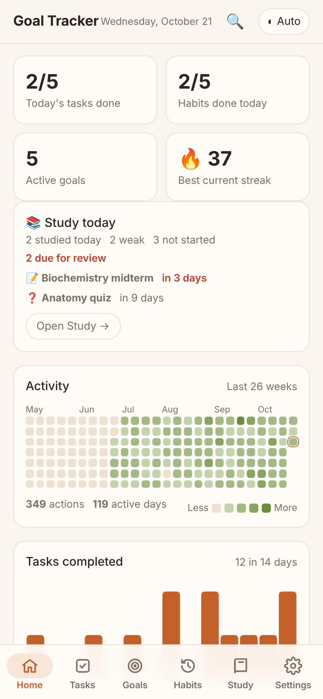
  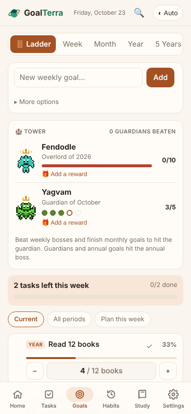
  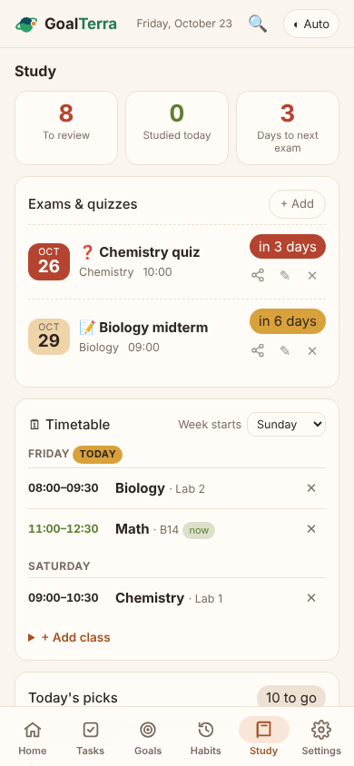
</p>

## Quick start

1. Download [`goal-tracker.html`](goal-tracker.html).
2. Open it in any modern browser (Chrome on Android works well).
3. On a phone, use **Add to Home screen** from the browser menu so it opens like an app.
4. The one-screen first-run intro lets you pick a language and tick a few starter habits, or explore with sample data you can clear later.

Your data lives in the browser's IndexedDB. **Back it up regularly** from Settings (see [Your data](#your-data-and-backups)).

## Features

### Today
- **Performance first**: a ring for today, the last 7 days as bars, this week against last week, your best streak and active goals
- **Three scores (0 to 1000)**: a **Habits** score (showing up counts, a half-tick counts, one isolated miss costs half), a **Tasks** score (priority and length earn more; tiny low-priority tasks are capped) and an **Overall** score (the geometric mean). They are slow 42-day averages with a week-on-week arrow. Tap a score for the formula. The weights are judgment calls, not validated science
- Below that: your open tasks (the first 4, with *Show all*), goals, and habits folded into one line, with a one-line add field
- A **day level** banner shows whether today is a ⚡ Spark, 🔥 Blaze or ⚔️ Titan day (tap it for a calendar of past levels). Insights hold a 26-week activity heatmap, tasks per day and habit consistency. The stat tiles are hidden by default
- Backup reminders sit at the bottom, and a dot on Settings shows when one is due
- One short, dismissible **tip card** per tab explains the basics the first time (Settings has *Show tips again*)

### Tasks
- **Smart quick add**: type `Essay tomorrow !high #uni` and the date, priority and tag fill themselves. Understands today, tomorrow, weekday names, *in 3 days*, *next week*, *25 oct*, *25/10* and Arabic phrases such as غدًا، بكرة، باچر، بعد غد، الخميس
- Due dates shown as a countdown (*Tomorrow*, *3 days left*, *2 days late*), priorities, notes and checklists
- **Calendar view**: a month grid of due and finished tasks; tap a day to see it or add to it
- **Focus timer**: start a 25-minute session (length is adjustable) from any task; it keeps time if the screen locks, and finished minutes are saved on the task
- **Info sheets**: tap a task, a goal or the week boss to see its full details, with Edit, Done and Focus buttons
- Repeating tasks, tag folders, sorting and filters, archive, bulk Select mode (long-press to start), Trash with Undo, and an icon for any task, goal or habit
- **Plan view** (add-on *Time blocking*): your day as a timeline. Give a task a start time and length, tap a block to nudge or resize it in 15-minute steps, overlaps are marked with ⚠, Undo covers every move, and swipe sideways to change day. Quick add understands "Gym at 6pm for 1h"; reminders ring before each block. You choose when your day starts and ends
- The last 5 titles and notes of a task or goal can be brought back from its edit screen

<p align="center">
  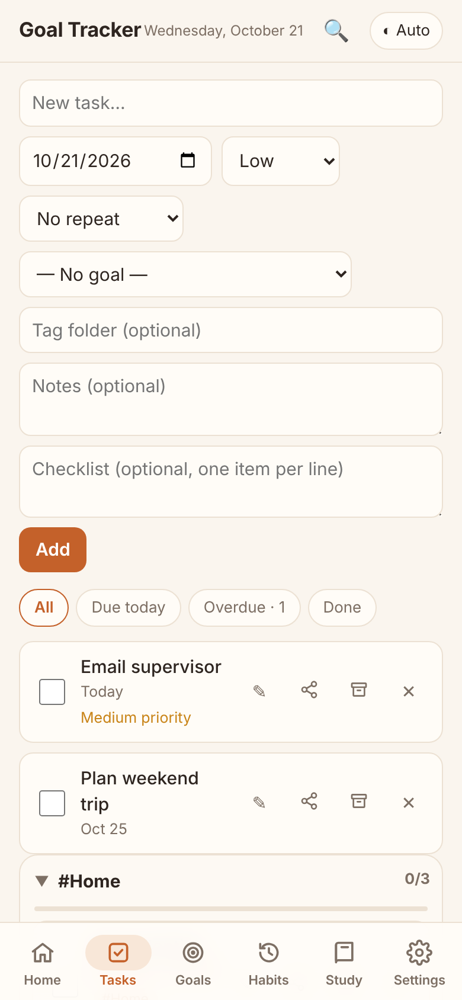
  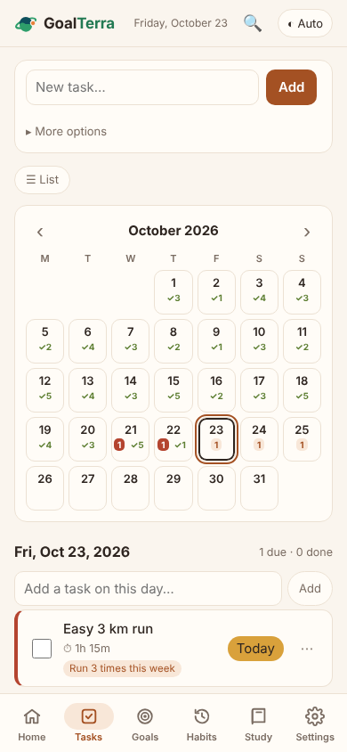
  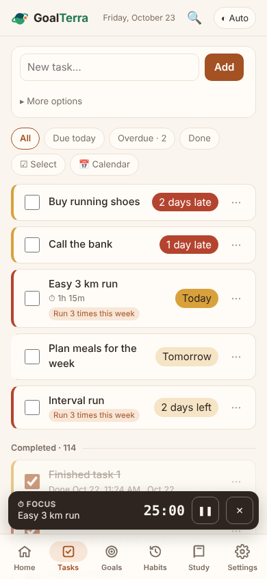
</p>

### Goals that connect
Weekly, monthly, annual and 5-year goals that **roll up into each other** on one **ladder**: finish the weekly steps and the monthly goal moves, and so on up to the 5-year goal.
- Measure a goal by a checkbox (or its linked tasks), a number target, or its sub-goals
- **Templates** to start fast: School year, Learn a skill, Get fit
- Weekly planning, end-of-period review, and a **monthly review** screen
- Deleted goals, exams and topics go to Trash for 30 days, like tasks and habits

### Habits
- Build habits and **avoid habits** (things to quit), in their own sections
- Schedules by weekday, folders, history calendar with backfilling
- Built on *Atomic Habits*: **never miss twice** (one missed day is forgiven, two in a row reset the streak), a Best streak on each card, a *Missed yesterday* nudge, milestones at 3, 7, 14, 30, 60 and 100 days, and a daily ring with a Perfect day celebration
- An optional **Make it stick** section per habit: identity votes, a two-minute version (a ½ tick counts), stacking after another habit, time and place with a reminder, a treat and an environment note
- A **Hardest habit** card offers a two-minute version. Habit rewards (the +XP pop-up) can be switched off in Settings

<p align="center">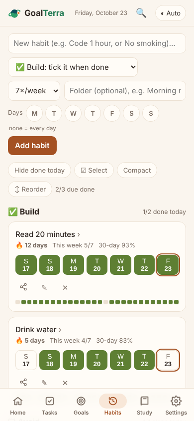</p>

### Game mode (optional)
Switch it on in Settings → Add-ons.
- **A weekly 8-bit boss**, generated fresh each week. Finishing tasks, habits, study sessions and focus time deals damage; priority, finishing early and Titan days hit harder. Its HP comes from the week you planned, so it can't be made easy on purpose
- **The tower**: a crowned monthly guardian beaten by weekly wins and monthly goals, an annual boss above it, and your 5-year goal as the final boss
- **Exam elites** in student mode: study for the subject to charge your preparation; your score decides the fight
- **Shields and counterattacks**: a day with no damage lets the boss hit back; clean days on avoid habits charge shields that block it. You never lose XP or levels
- **Rest tokens** (one per boss beaten) protect streaks on a sick day, and you can attach **your own real rewards** to any boss
- A defeated boss stays defeated, extra damage gives a small overkill XP bonus, and one huge week raises the next boss by at most 25%
- Hero level, stats earned from what you actually do, 11 **badges** you keep once earned, a weeks-won-in-a-row counter, and a **Bestiary** of every monster beaten or escaped. Tap ? on the game card for a plain-words *How the game works* sheet

<p align="center">
  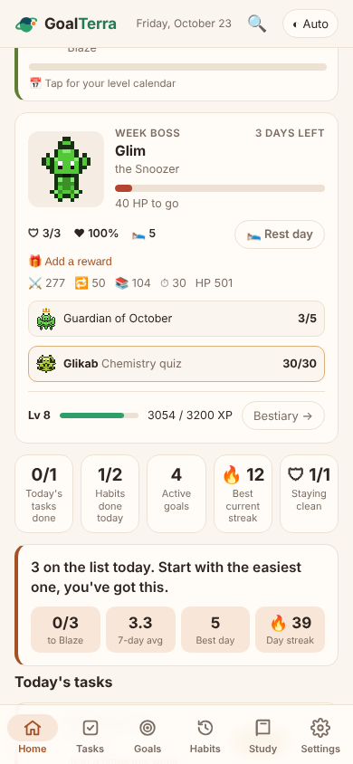
  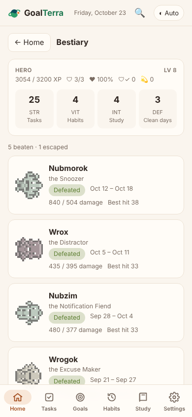
</p>

### Student mode
Turn on the *Student* add-on (Settings → Add-ons) to get a **Study** tab built around Ali Abdaal's [retrospective revision timetable](https://aliabdaal.com/studying/how-to-study-the-power-of-retrospective-revision-timetables/):
- Subjects and topics rated **Weak, OK or Strong** per day, with backfilling
- **Today's picks** come first: weak, untouched, due-for-review topics, and subjects you have class in today. Five show by default (*Show all* for the rest) and ratings have Undo
- **Spaced repetition** with editable intervals, shorter before an exam
- **Exam and quiz logger** with countdowns and scores
- **Class timetable** (collapsed by default) with rooms and times; the week can start on Saturday, Sunday or Monday

<p align="center">
  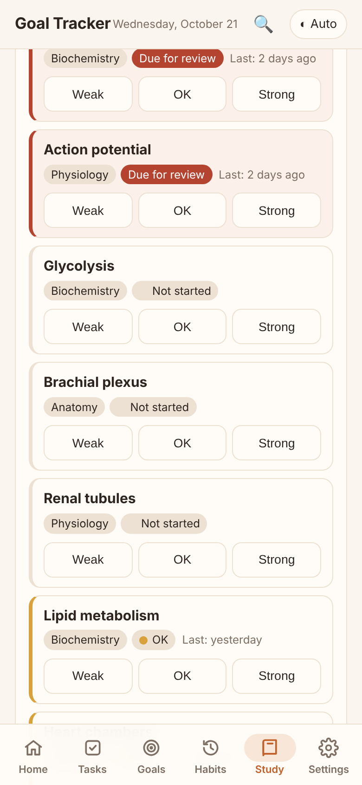
  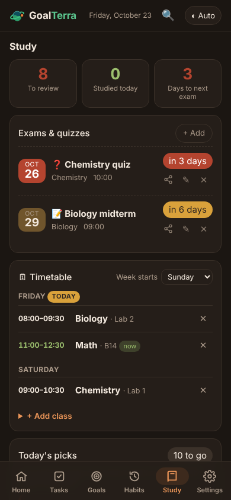
  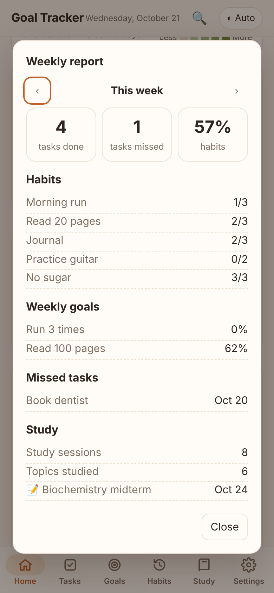
</p>

### Reports
The **weekly report** covers tasks, habits, goals, study, day levels, focus time and the week's boss. The **monthly review** adds your best week, goals finished at every level and the month's guardian.

<p align="center">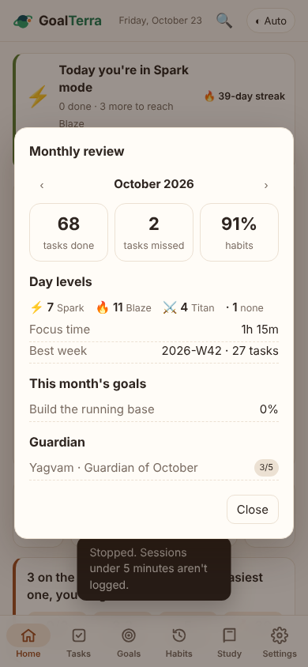</p>

### Share with friends (JSON)
Pick habits, tasks or homework, exams and quizzes, and study topics, and send them as a small `.json` file, copied text, or through your phone's share sheet. Your friend imports it with a preview first; duplicates are skipped. History, scores and personal data are never included.

<p align="center">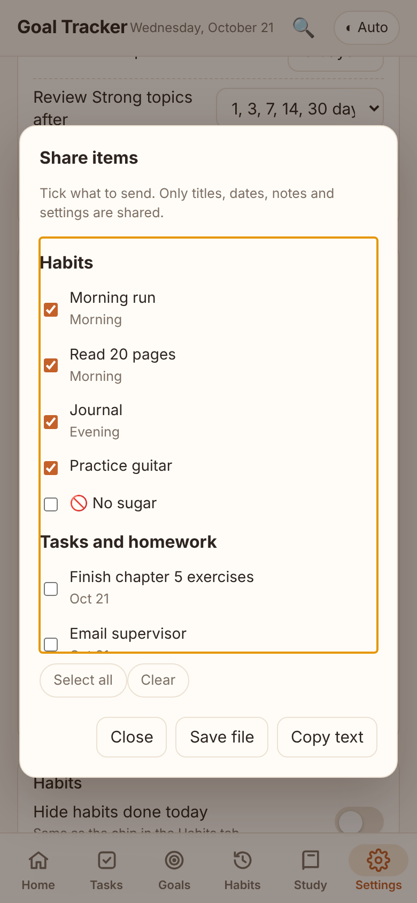</p>

### Themes and settings
Six colour palettes (Clay, Terra, Ocean, Grape, Rose, Graphite), each in light and dark, plus a pure **Black (OLED)** mode. Every palette passes WCAG 4.5:1 text contrast. Settings show six cards plus a collapsed **Advanced** block. **Add-ons** switch Study, Time blocking, Game mode and the coach on or off (the coach is off by default). Other options cover language, sounds and a short vibration where the phone allows it, task defaults, focus and break length, the 12 or 24 hour clock, the calendar's first weekday, day-level thresholds, avoid-habit behaviour and spaced repetition.

<p align="center">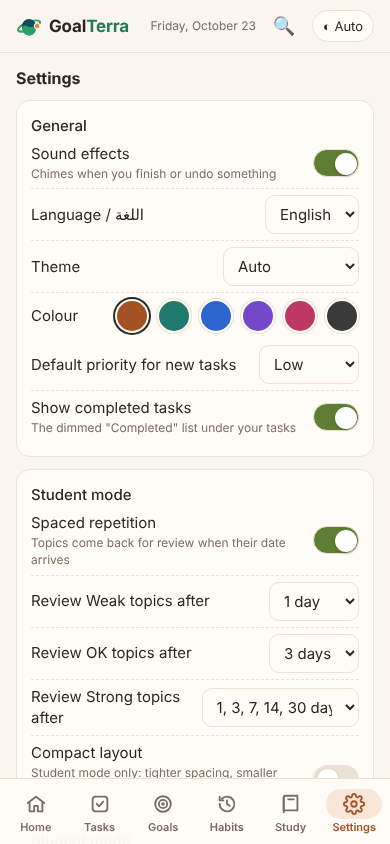</p>

### Arabic and right-to-left
Settings → Language switches the whole app to Arabic with a mirrored right-to-left layout, Arabic dates and Arabic coach messages. Your own text is never translated.

<p align="center">
  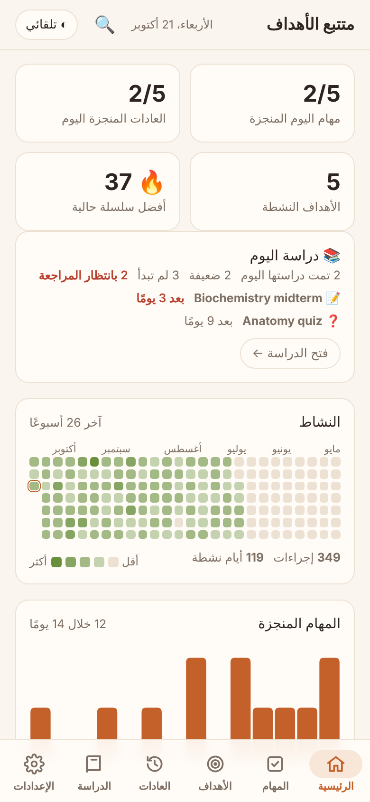
  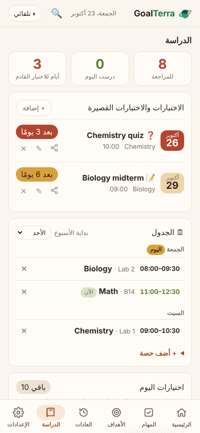
  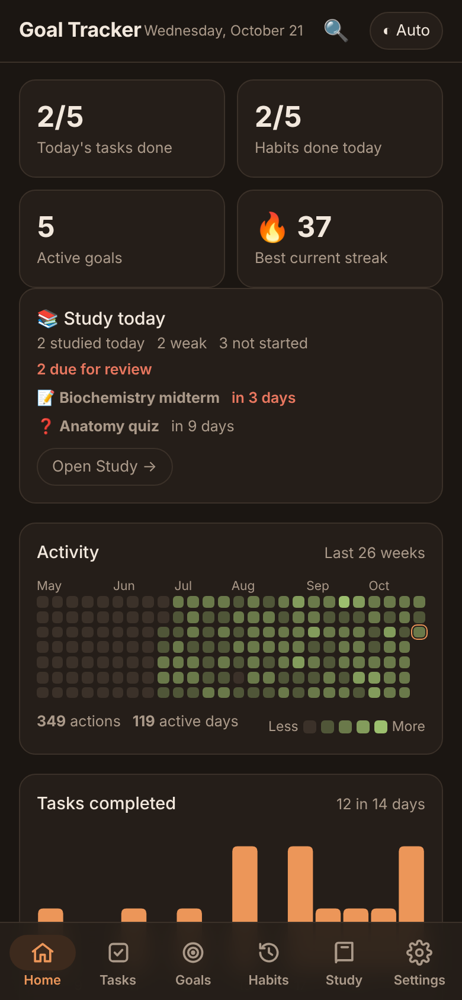
</p>

## Your data and backups

- Everything is stored locally. Nothing is uploaded anywhere
- **Back up now** saves a dated `goalterra-YYYY-MM-DD.json` file. **Restore** shows a preview first (what the backup holds, when it was made, and how it compares with your data now) before anything is replaced
- **Automatic daily backup** (Settings → Storage & backup): pick a time. In the Android app it saves quietly to `Documents/GoalTerra` (the last 7 are kept) when the app is open after that time, and a reminder rings at that time if it isn't. A browser can't save files by itself, so it shows a *Back up now* card instead
- The backup reminder escalates if you go 30 days without one; older backups keep loading in newer versions
- **Safety copies**: the app keeps its own snapshots (the newest 10) in a separate store, saved daily, when the app updates, and before a restore, an erase or a data repair. Settings has a Restore list for them. They live on the same device, so they are not a substitute for a real backup
- **Erase everything** needs a typed word and can be undone. Bulk Done, Archive and Edit have Undo too
- **Check my data** finds and fixes broken links between tasks, goals and habits
- Clearing the browser's site data deletes your data (safety copies included), so keep a backup

## Android app

GoalTerra also runs as a real Android app (Android 7 and newer), built from the same `goal-tracker.html`.

**Install**
1. Open the repository's **Releases** page on your phone and download the newest `GoalTerra-x.y.z.apk`.
2. Tap it. The first time, Android asks you to allow installs from your browser or Files app.
3. Updates install over the old version and keep your data, because every build is signed with the same key.

**What the app adds**
- **Backups and exports** save to `Documents/GoalTerra` on the phone and open the share sheet, so you can also send them to Drive, email or a chat. **Restore** opens the phone's file picker
- **Notifications**: a morning plan, an evening check-in (with the boss warning in Game mode), class reminders 10 minutes before, exam reminders the evening before, the focus timer, and a backup reminder. Times and switches are in Settings → Notifications
- The back button closes dialogs and returns to Home, the status bar follows the theme, and the app has its own icon and splash screen

Your browser data and the app's data are separate. To move over, use **Back up now** in the browser and **Restore** in the app.

**How it is built**
`android-app/` is a [Capacitor](https://capacitorjs.com) project. `npm run sync` copies `goal-tracker.html` into the app and adds the Capacitor runtime next to it (the web file itself stays network-free). The GitHub Actions workflow `.github/workflows/android.yml` builds the APK on every change and publishes it as a release; the app's version always matches `APP_VERSION`.

To build locally you need Node 22, JDK 21 and the Android SDK:
```
cd android-app
npm ci
npm run build:debug        # APK in android/app/build/outputs/apk/debug/
```
Debug builds use the fixed key in `android-app/keys/debug.keystore` (a public debug key). For a Play Store release, create your own upload key, keep it safe, and build with `GT_KEYSTORE`, `GT_KEYSTORE_PASSWORD`, `GT_KEY_ALIAS` and `GT_KEY_PASSWORD` set (`npm run build:release`).

## Development

The app you run is the single file `goal-tracker.html`, and you never need a build step to use it. To work on it, edit the pieces in `src/` (see `src/README.md` for a code map), then run `npm run build` (or `node build.mjs`) to regenerate `goal-tracker.html`. `node build.mjs --check` fails if the generated file is stale. The Android app copies the generated file as is.

A Playwright test suite (development only, never part of the app) lives in `tests/`:

```
pip install playwright        # Chromium must be available to Playwright
npm install                   # once, for Prettier (`npm run format`)
tests/run.sh                  # every check: light, dark and Arabic, overflow, page errors
tests/run.sh qa focus         # only some tests
python3 tests/screenshots.py  # regenerate the README screenshots from demo data
```

## Versions

The app follows [semantic versioning](https://semver.org) and the full changelog is at the top of `src/00-head.html` (and of the generated `goal-tracker.html`). The current version is shown in Settings.

## Privacy

No analytics, no accounts, no network requests. The whole app is the single HTML file in this repository.
