<p align="center"></p>

# GoalTerra

*Formerly Goal Tracker.*

A free, private goal, habit, task and study tracker in **one HTML file**. No account, no server, no tracking: everything is stored on your own device. It works offline and is built for phones first (it also works on a desktop browser), in **English and Arabic**.

<p align="center">
  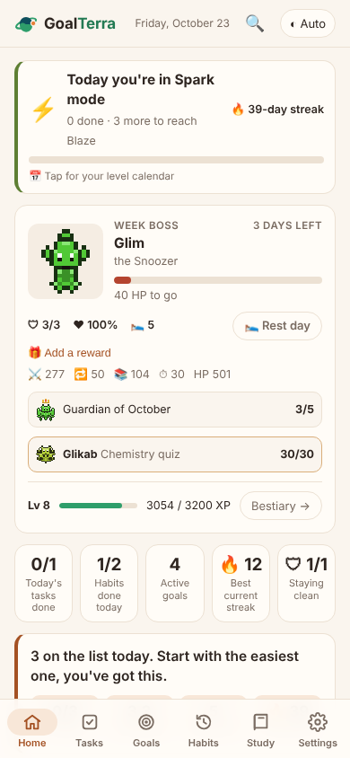
  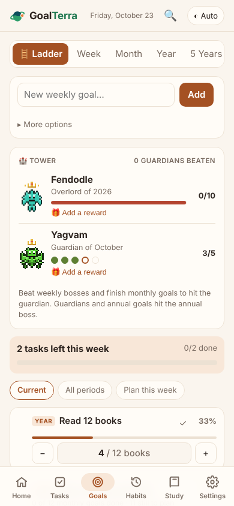
  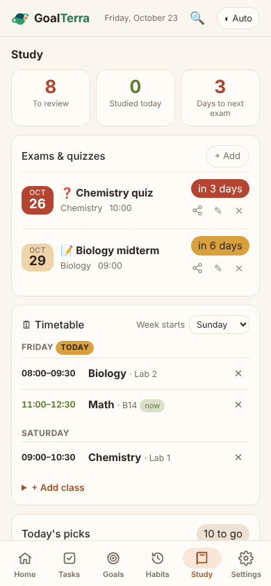
</p>

## Quick start

1. Download [`goal-tracker.html`](goal-tracker.html).
2. Open it in any modern browser (Chrome on Android works well).
3. On a phone, use **Add to Home screen** from the browser menu so it opens like an app.
4. The first-run intro lets you pick a language, start from a template, or explore with sample data you can clear later.

Your data lives in the browser's IndexedDB. **Back it up regularly** from Settings (see [Your data](#your-data-and-backups)).

## Features

### Dashboard
Today's tasks, habits and goals at a glance. A **day level** banner shows whether today is a ⚡ Spark, 🔥 Blaze or ⚔️ Titan day (tap it for a calendar of past levels), and a coach message pushes harder as your level rises. Insights hold a 26-week activity heatmap, tasks per day and habit consistency. Every section can be switched off in Settings.

### Tasks
- **Smart quick add**: type `Essay tomorrow !high #uni` and the date, priority and tag fill themselves. Understands today, tomorrow, weekday names, *in 3 days*, *next week*, *25 oct*, *25/10* and Arabic phrases such as غدًا، بكرة، باچر، بعد غد، الخميس
- Due dates shown as a countdown (*Tomorrow*, *3 days left*, *2 days late*), priorities, notes and checklists
- **Calendar view**: a month grid of due and finished tasks; tap a day to see it or add to it
- **Focus timer**: start a 25-minute session (length is adjustable) from any task; it keeps time if the screen locks, and finished minutes are saved on the task
- Repeating tasks, tag folders, sorting and filters, archive, bulk Select mode, Trash with Undo

<p align="center">
  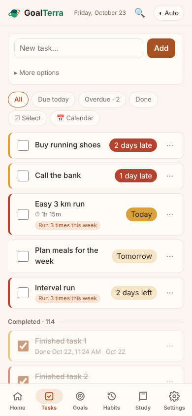
  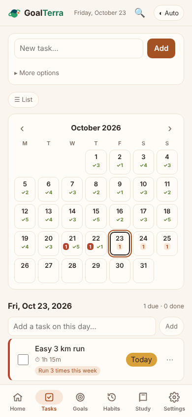
  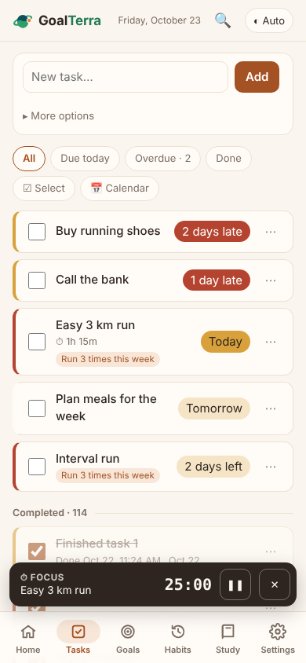
</p>

### Goals that connect
Weekly, monthly, annual and 5-year goals that **roll up into each other** on one **ladder**: finish the weekly steps and the monthly goal moves, and so on up to the 5-year goal.
- Measure a goal by a checkbox (or its linked tasks), a number target, or its sub-goals
- **Templates** to start fast: School year, Learn a skill, Get fit
- Weekly planning, end-of-period review, and a **monthly review** screen

### Habits
- Build habits and **avoid habits** (things to quit), in their own sections
- Schedules by weekday, folders, history calendar with backfilling, streaks

<p align="center">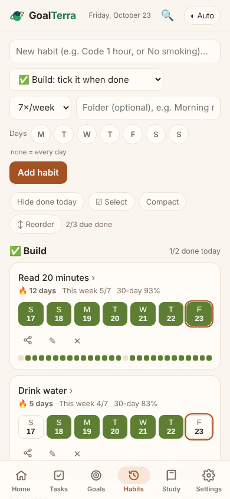</p>

### Game mode (optional)
Switch it on in Settings → Game mode.
- **A weekly 8-bit boss**, generated fresh each week. Finishing tasks, habits, study sessions and focus time deals damage; priority, finishing early and Titan days hit harder. Its HP comes from the week you planned, so it can't be made easy on purpose
- **The tower**: a crowned monthly guardian beaten by weekly wins and monthly goals, an annual boss above it, and your 5-year goal as the final boss
- **Exam elites** in student mode: study for the subject to charge your preparation; your score decides the fight
- **Shields and counterattacks**: a day with no damage lets the boss hit back; clean days on avoid habits charge shields that block it. You never lose XP or levels
- **Rest tokens** (one per boss beaten) protect streaks on a sick day, and you can attach **your own real rewards** to any boss
- Hero level, stats earned from what you actually do, and a **Bestiary** of every monster beaten or escaped

<p align="center">
  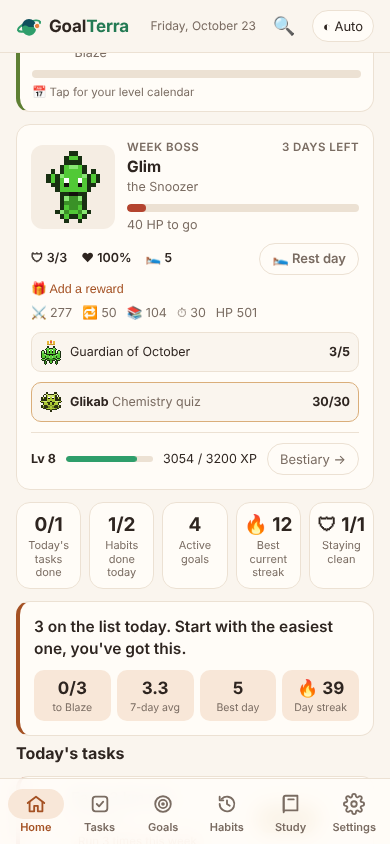
  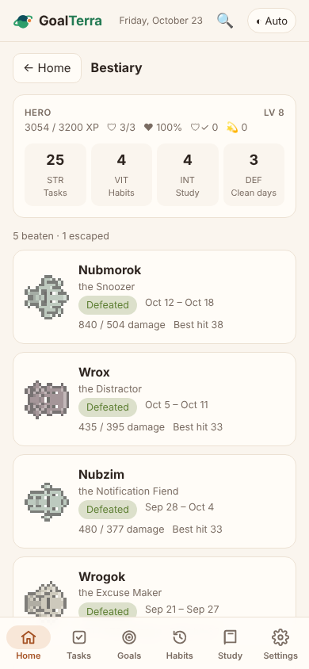
</p>

### Student mode
Turn it on in Settings to get a **Study** tab built around Ali Abdaal's [retrospective revision timetable](https://aliabdaal.com/studying/how-to-study-the-power-of-retrospective-revision-timetables/):
- Subjects and topics rated **Weak, OK or Strong** per day, with backfilling
- **Today's picks**: weak, untouched, due-for-review topics first, and subjects you have class in today
- **Spaced repetition** with editable intervals, shorter before an exam
- **Exam and quiz logger** with countdowns and scores
- **Class timetable** with rooms and times; the week can start on Saturday, Sunday or Monday

<p align="center">
  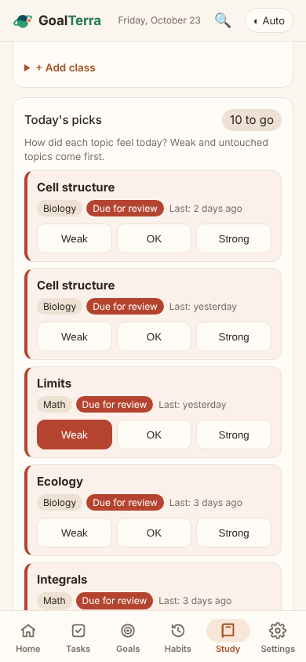
  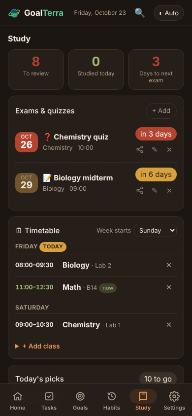
  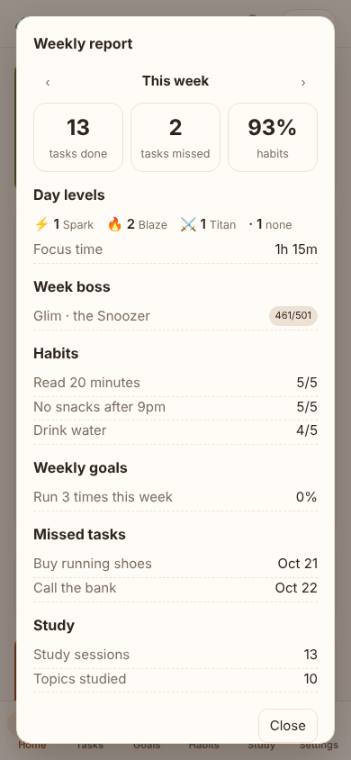
</p>

### Reports
The **weekly report** covers tasks, habits, goals, study, day levels, focus time and the week's boss. The **monthly review** adds your best week, goals finished at every level and the month's guardian.

<p align="center">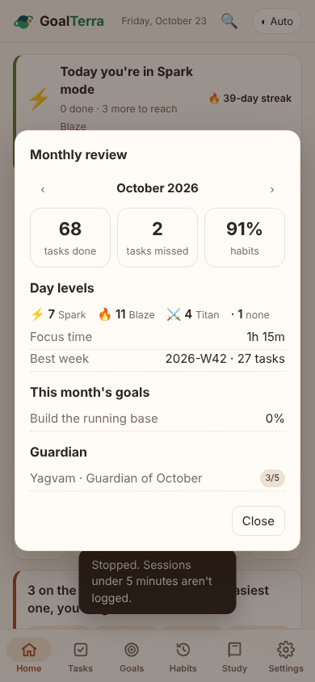</p>

### Share with friends (JSON)
Pick habits, tasks or homework, exams and quizzes, and study topics, and send them as a small `.json` file, copied text, or through your phone's share sheet. Your friend imports it with a preview first; duplicates are skipped. History, scores and personal data are never included.

<p align="center">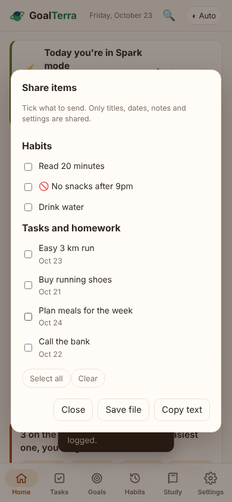</p>

### Themes and settings
Six colour palettes (Clay, Terra, Ocean, Grape, Rose, Graphite), each in light and dark, plus a pure **Black (OLED)** mode. Every palette passes WCAG 4.5:1 text contrast. Settings also cover language, sounds, task defaults, focus and break length, day-level thresholds, avoid-habit behaviour, spaced repetition, student mode and game mode.

<p align="center">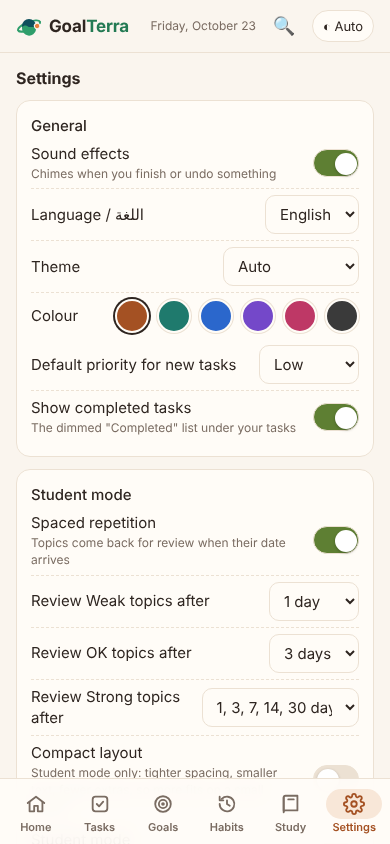</p>

### Arabic and right-to-left
Settings → Language switches the whole app to Arabic with a mirrored right-to-left layout, Arabic dates and Arabic coach messages. Your own text is never translated.

<p align="center">
  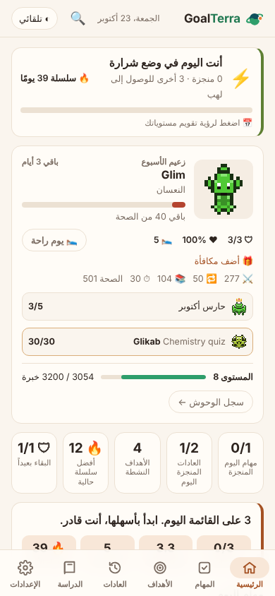
  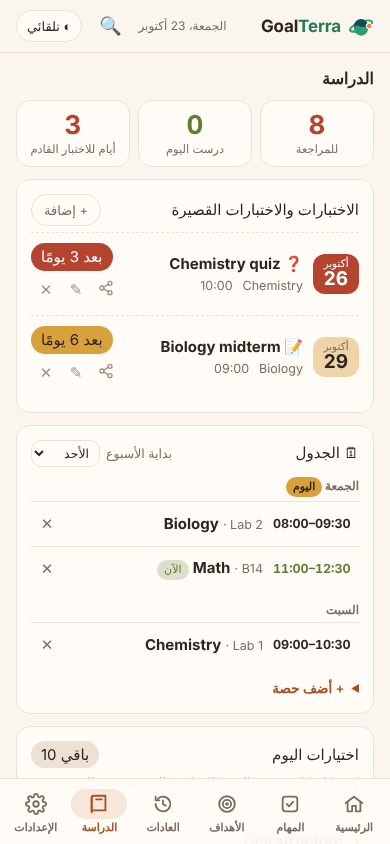
  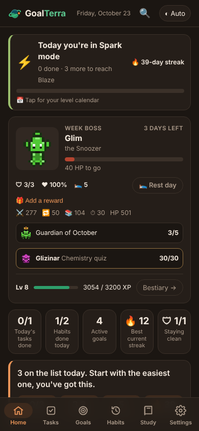
</p>

## Your data and backups

- Everything is stored locally. Nothing is uploaded anywhere
- **Back up now** saves a dated `goalterra-YYYY-MM-DD.json` file. Restoring shows a preview first (what the backup holds, when it was made, and how it compares with your data now) before anything is replaced
- The backup reminder escalates if you go 30 days without one; older backups keep loading in newer versions
- Clearing the browser's site data deletes your data, so keep a backup

## Development

The app is the single file `goal-tracker.html`. There is no build step for it.

A Playwright test suite (development only, never part of the app) lives in `tests/`:

```
pip install playwright        # Chromium must be available to Playwright
tests/run.sh                  # every check: light, dark and Arabic, overflow, page errors
tests/run.sh qa focus         # only some tests
python3 tests/screenshots.py  # regenerate the README screenshots from demo data
```

## Versions

The app follows [semantic versioning](https://semver.org) and the full changelog is at the top of `goal-tracker.html`. The current version is shown in Settings.

## Privacy

No analytics, no accounts, no network requests. The whole app is the single HTML file in this repository.
